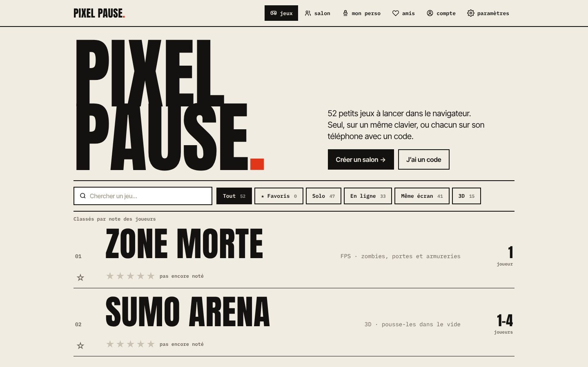
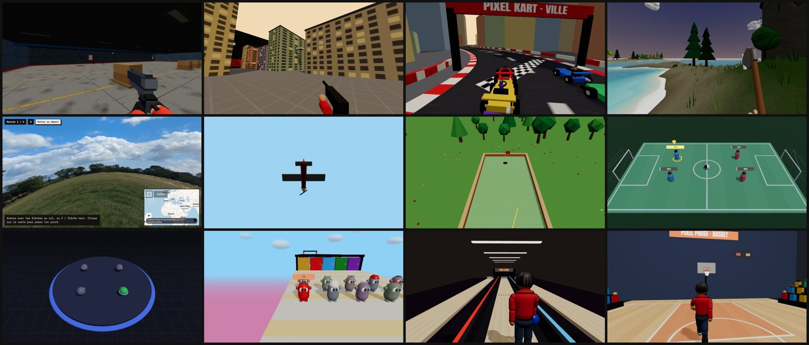
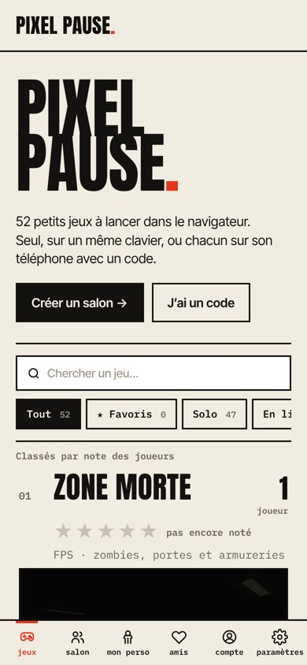
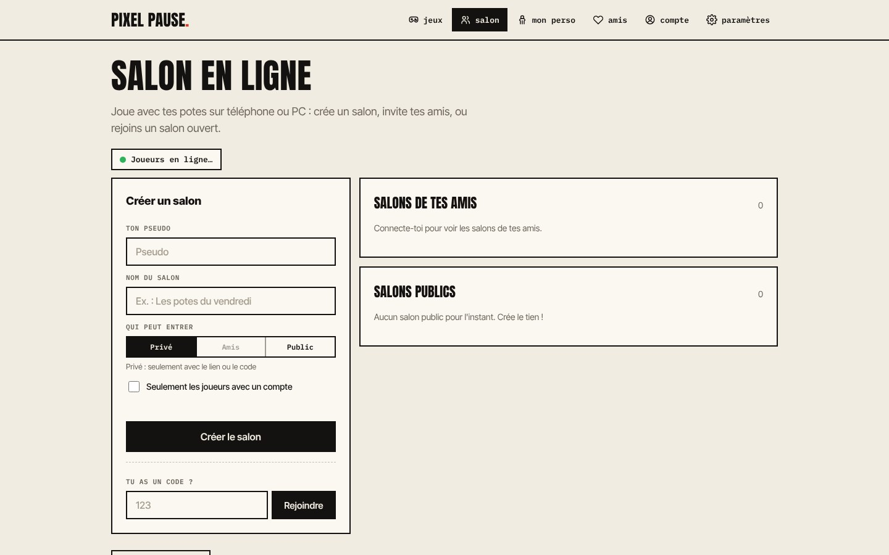
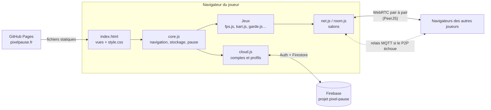

<div align="center">

# PIXEL PAUSE.

**52 mini-jeux jouables dans le navigateur, seul, sur le même clavier ou entre potes en ligne.**

[](https://pixelpause.fr)
[](#stack-technique)
[](#stack-technique)
[](#stack-technique)
[](#architecture)
[](#déploiement)

**[▶ Jouer sur pixelpause.fr](https://pixelpause.fr)**



</div>

---

## Sommaire

- [Le projet](#le-projet)
- [Aperçu](#aperçu)
- [Les jeux](#les-jeux)
- [Fonctionnalités](#fonctionnalités)
- [Stack technique](#stack-technique)
- [Architecture](#architecture)
- [Organisation du code](#organisation-du-code)
- [Sécurité](#sécurité)
- [Lancer le projet en local](#lancer-le-projet-en-local)
- [Déploiement](#déploiement)
- [Compétences mises en œuvre (BTS SIO)](#compétences-mises-en-œuvre-bts-sio)
- [Auteur](#auteur)

---

## Le projet

Pixel Pause est un site de jeux que j'ai conçu et développé seul, de l'idée à la mise en ligne.
L'objectif : pouvoir lancer une partie en deux secondes, sans installer quoi que ce soit, sur PC comme sur téléphone, et jouer avec ses amis grâce à un simple code de salon.

- **52 jeux** : FPS en 3D, course de karts, tower defense, jeux d'ambiance, échecs, casino, quiz…
- **Multijoueur en ligne** : salons à code, chat, invitations, votes pour le prochain jeu.
- **Comptes en ligne** : inscription, personnage 3D personnalisable, amis, messages privés, classements.
- **Aucun framework, aucune étape de build** : du HTML, du CSS et du JavaScript écrits à la main, servis tels quels par GitHub Pages.

## Aperçu

| Une partie des jeux | Version mobile |
|:---:|:---:|
|  |  |

<div align="center">

<br><sub>Création d'un salon : privé (code), réservé aux amis ou public, avec option « comptes uniquement ».</sub>
</div>

## Les jeux

### Les incontournables

| Jeu | Genre | Joueurs |
|---|---|:---:|
| **Zone Morte** | FPS 3D en vagues de zombies : portes payantes, armureries, réanimation des coéquipiers | solo ou coop |
| **Voltige** | Shooter de mouvement dans une grande ville : course sur les murs, double saut, grappin | 1 à 8 |
| **DEFEND MONTREUIL** | Tower defense à invocations : fusionne tes gardiens, tiens 80 vagues et des boss | 1 à 2 |
| **Pixel Kart** | Course de karts 3D, 3 circuits, dérapage turbo, objets, écran partagé | 1 à 8 |
| **Survie** | Île en 3D : artisanat, construction de base, cycle jour/nuit | 1 à 8 |
| **Devine où** | Vue de rue à 360° : devine où tu es et pose ton point sur la carte | 1 à 12 |
| **Dernier Debout** | 3 épreuves éliminatoires en 3D, 12 concurrents avec les bots | 1 à 8 |
| **Sumo Arena** / **Foot 2v2** | Jeux 3D à 4 sur un seul clavier, bots pour compléter | 1 à 4 |

### Tout le catalogue

| Catégorie | Jeux |
|---|---|
| **Action et 3D** | Zone Morte, Voltige, Survie, Avion 3D, Labyrinthe 3D, Coup de Bâton, Bitume, Néon Rush |
| **Course et sport** | Pixel Kart, Foot 2v2, Sumo Arena, Tennis 3D, Basket 3D, Bowling 3D, Mini-golf 3D, Tir à l'arc 3D, Billard, Air Hockey |
| **Entre potes** | Mot imposteur, Le plus probable, Dessine et devine, Quiz, Réflexes, Course de frappe, Dernier Debout, Devine où, Quand et où |
| **Stratégie et réflexion** | DEFEND MONTREUIL, Guerre des Tours, Échecs, Quatre en ligne, Bataille navale, Démineur, Memory, Blocs, Potions, Débouche moi, Câbles |
| **Arcade** | Paquet Snake, Serpents, Saute-Pixel, Casse-Briques Néon, Pong néon, Tanks, Envol, Tour Infinie, Marzoukeur |
| **Casino (jetons fictifs)** | Blackjack, Poker Texas Hold'em, La Roue, Roulette russe |
| **Apprendre** | **Terminal** : un faux terminal pour apprendre les vraies commandes Linux |

## Fonctionnalités

**Jouer**
- Recherche et filtres (Solo, En ligne, Même écran, 3D, Favoris), jeux classés par la note des joueurs.
- Pause, plein écran et reprise sur tous les jeux ; records et statistiques sauvegardés.
- Contrôles tactiles automatiques sur téléphone (joystick, boutons), clavier AZERTY et QWERTY pris en charge.
- Paramètres : langue FR / EN, touches personnalisables.

**Jouer ensemble**
- Salon avec code à 3 chiffres ou lien direct, visibilité privée / amis / public.
- Chat avec emojis, expulsion, passage de l'hôte, propositions de jeu votées par le salon.
- Modes en ligne dans de nombreux jeux (Zone Morte en coopération, Kart, Quatre en ligne, Quiz…).

**Communauté**
- Comptes : e-mail + mot de passe ou Google, vérification de l'adresse e-mail, contrôle des nouveaux appareils.
- Personnage 3D à personnaliser, réutilisé dans plusieurs jeux.
- Amis, demandes, présence en ligne, messages privés, invitations dans un salon.
- Classements en ligne et notes des jeux partagées entre tous les joueurs.

**Administration**
- Tableau de bord réservé à l'administrateur : joueurs en ligne, statistiques quotidiennes, temps de jeu, désactivation d'un jeu, bannissement.

## Stack technique

| Domaine | Technologies |
|---|---|
| Front-end | HTML5, CSS3, JavaScript (ES5/ES6) sans framework, Canvas 2D |
| 3D | [three.js](https://threejs.org/) (WebGL) |
| Cartes | [MapLibre GL](https://maplibre.org/) + [OpenFreeMap](https://openfreemap.org/) |
| Son | Web Audio API (effets générés par le code, sans fichiers audio) |
| Temps réel | WebRTC pair à pair via [PeerJS](https://peerjs.com/), relais MQTT sur WebSocket en secours |
| Back-end (BaaS) | Firebase Authentication, Cloud Firestore (règles de sécurité) |
| Hébergement | GitHub Pages, nom de domaine personnalisé `pixelpause.fr` (DNS + HTTPS) |
| Outils | Git / GitHub, navigateur headless pour les captures et les tests |

## Architecture



**Choix principaux**

- **Site 100 % statique** : aucun serveur à maintenir, hébergement gratuit, mise en ligne par simple `git push`.
- **Parties en pair à pair** : l'hôte du salon fait tourner la partie et diffuse l'état aux autres joueurs. Pas de serveur de jeu, donc pas de coût et une latence faible.
- **Firebase pour ce qui doit être partagé et durable** : comptes, profils, amis, messages, salons publics, classements, notes et statistiques.
- **Un fichier par jeu** : chaque jeu s'enregistre auprès du noyau (`core.js`) avec ses fonctions d'ouverture et de fermeture, ce qui garantit qu'un jeu quitté s'arrête vraiment.
- **Cache maîtrisé** : chaque script est chargé avec un numéro de version (`?v=`) et le site propose de recharger quand une nouvelle version est publiée.

**Collections Firestore**

| Collection | Contenu |
|---|---|
| `users` | Données privées du compte (appareils connus) |
| `profiles` | Profil public : pseudo, personnage, présence, records |
| `usernames` | Réservation des pseudos (unicité) |
| `friends` / `chats` | Liste d'amis et messages privés |
| `rooms` | Annuaire des salons ouverts |
| `ratings` | Notes des jeux |
| `stats`, `presence`, `config`, `banned`, `admin` | Statistiques, joueurs en ligne, réglages du site, modération |

## Organisation du code

```
.
├── index.html          page unique : toutes les vues du site
├── style.css …         styles (site, mobile, tactile, salons, réglages)
├── core.js             noyau : navigation, stockage, pause, plein écran
├── net.js, room.js     salons en ligne (WebRTC + relais), écran du salon
├── cloud.js            comptes Firebase, synchronisation du profil
├── account.js, friends.js, perso.js, hub.js   compte, amis, personnage 3D, connexion
├── scores.js, stats.js, admin.js              classements, statistiques, administration
├── settings.js, langs.js, touch.js            réglages, traductions, contrôles tactiles
├── arcade*.js          moteur commun et jeux « arcade »
├── fps.js, kart.js, garde.js, volt.js …       un fichier par jeu
├── thumb-*.jpg/svg     vignettes des jeux
├── 404.html            liens courts /ami/pseudo vers un profil
└── docs/captures/      images de ce README
```

## Sécurité

- **Règles Firestore** : chaque joueur ne peut modifier que ses propres données ; les messages ne sont lisibles que par les deux participants ; les fonctions d'administration sont réservées au compte administrateur.
- **Comptes** : mot de passe d'au moins 8 caractères avec lettre et chiffre, vérification de l'e-mail obligatoire pour les fonctions sociales, confirmation par e-mail lors d'une connexion depuis un nouvel appareil.
- **Salons** : possibilité de les réserver aux amis ou aux joueurs ayant un compte, expulsion par l'hôte, bannissement par l'administrateur.
- **Affichage** : les textes saisis par les joueurs (pseudos, chat) sont échappés avant affichage pour éviter l'injection de HTML.
- La configuration web de Firebase présente dans le code est publique par conception : la protection des données repose sur l'authentification et les règles côté serveur, pas sur le secret de cette configuration.

## Lancer le projet en local

Aucune installation ni compilation n'est nécessaire.

```bash
git clone https://github.com/Anismk077/pixel-pause.git
cd pixel-pause
python3 -m http.server 8000
# puis ouvrir http://localhost:8000
```

Il vaut mieux passer par un petit serveur local plutôt que d'ouvrir `index.html` en double-cliquant : sinon les salons en ligne et certaines cartes ne fonctionnent pas.

## Déploiement

Le dépôt est publié automatiquement par **GitHub Pages** à chaque envoi sur la branche `main`.
Le fichier `CNAME` relie le site au domaine **pixelpause.fr**, avec HTTPS activé.

## Compétences mises en œuvre (BTS SIO)

| Compétence | Dans ce projet |
|---|---|
| Concevoir et développer une solution applicative | Site complet, 52 jeux, architecture modulaire un fichier par jeu |
| Gérer le patrimoine informatique | Versionnage Git, numéros de version des fichiers, gestion du cache |
| Mettre à disposition un service informatique | Hébergement GitHub Pages, nom de domaine, DNS, HTTPS |
| Travailler en mode projet | Évolutions par versions successives, audit des bugs, corrections suivies |
| Sécuriser les données | Authentification, règles Firestore, vérification d'e-mail, modération |
| Réseau | Communication temps réel en WebRTC pair à pair, relais de secours en MQTT |

## Auteur

**Anis Marzouk**, étudiant en BTS SIO.

- Le site : [pixelpause.fr](https://pixelpause.fr)
- Mon portfolio : [anismk.fr](https://anismk.fr)
- GitHub : [@Anismk077](https://github.com/Anismk077)

<sub>Projet personnel, réalisé de A à Z. Les jeux de casino utilisent uniquement des jetons fictifs, sans argent réel.</sub>
